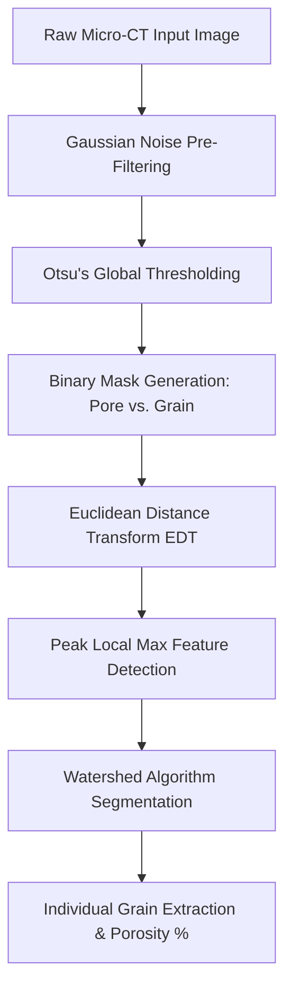

# 🔬 Digital Rock Physics: Micro-CT Grain Segmentation & Porosity Analysis

> **"This is an introductory project in this field, requiring further refinement and validation with real data sets.. Suggestions, corrections, and feedback are always welcome!"**

---

## 🚀 1. Introduction (Start)
**Digital Rock Physics (DRP)** uses high-resolution three-dimensional and two-dimensional images — obtained via **X-ray Micro-Computed Tomography ($\mu$-CT)** — to characterize the microstructures of reservoir rocks without destroying the physical sample.

This project aims to implement a computational Python pipeline to:
1. Simulate a 2D micro-CT rock section containing mineral grains and pore space.
2. Apply Gaussian noise pre-filtering.
3. Perform binarization using **Otsu's thresholding**.
4. Execute individual grain segmentation using the **Watershed** algorithm (based on the Euclidean Distance Transform).
5. Calculate the total **porosity** of the sample.

---

## 📚 2. Theoretical Background

### A. Otsu's Thresholding
Otsu's method is a non-parametric global thresholding technique. The algorithm assumes the image contains two classes of pixels (pores and mineral grains) and exhaustively calculates the optimal threshold ($t$) that **minimizes intra-class variance** (or maximizes inter-class variance), cleanly separating the peaks in the tomographic gray-level intensity histogram.

### B. Distance Transform and Watershed
In real rocks, mineral grains are frequently in contact with one another. To separate them, the following techniques are used:
* **Euclidean Distance Transform (EDT):** Calculates the minimum distance from each pore/grain pixel to the nearest background/boundary.
* **Watershed Algorithm:** Treats the distance image as a topographic relief (where distance peaks represent grain centers and boundaries represent valleys), "flooding" them to create dividing lines that separate adjacent grains.

---

## 🔄 3. Pipeline Workflow

## 📐 4. Mathematical Formulas

### 1. Otsu's Inter-Class Variance ($\sigma_B^2$):
The optimal threshold $t^*$ is chosen by maximizing the following equation:

$$\sigma_B^2(t) = \omega_0(t) \omega_1(t) [\mu_0(t) - \mu_1(t)]^2$$

Where:
* $\omega_0$ and $\omega_1$ are the probabilities of occurrence for the two classes (pores and grains).
* $\mu_0$ and $\mu_1$ are the mean gray-level intensities of each class.

### 2. Porosity Calculation ($\phi$):
The porosity of the 2D sample is calculated as the ratio between the area of pore pixels (background/empty space) and the total area of the image:

$$\phi = \left( \frac{N_{\text{pore}}}{N_{\text{total}}} \right) \times 100\%$$

Where:
* $N_{\text{pore}}$ is the number of pixels classified as porosity.
* $N_{\text{total}}$ is the total number of pixels in the image matrix.

---

## 🛠️ 5. Technologies and Libraries Used
* **Python 3.x**
* **NumPy:** Matrix computation and array manipulation.
* **SciPy (`ndimage`):** Distance transform and n-dimensional matrix processing.
* **Scikit-Image (`skimage`):** Gaussian filters, Otsu thresholding, watershed transforms, and local maximum identification.
* **Matplotlib:** Graphical visualization of results.

---

## 📖 6. References

1. **Otsu, N. (1979).** *A threshold selection method from gray-level histograms.* IEEE Transactions on Systems, Man, and Cybernetics, 9(1), 62-66.
2. **Andrä, H., et al. (2013).** *Digital rock physics: Benchmarking computer simulations on micro-CT images.* Computers & Geosciences, 50, 25-32.
3. **Vincent, L., & Soille, P. (1991).** *Watersheds in digital spaces: an efficient algorithm based on immersion simulations.* IEEE Transactions on Pattern Analysis and Machine Intelligence, 13(6), 583-598.
4. **Dvorkin, J., Gutierrez, M., & Grana, D. (2014).** *Seismic Reflections of Rock Properties.* Cambridge University Press.

---

## 👤 Author
* **Yana Pinheiro** 
* Student / Researcher in Computational Geophysics.
